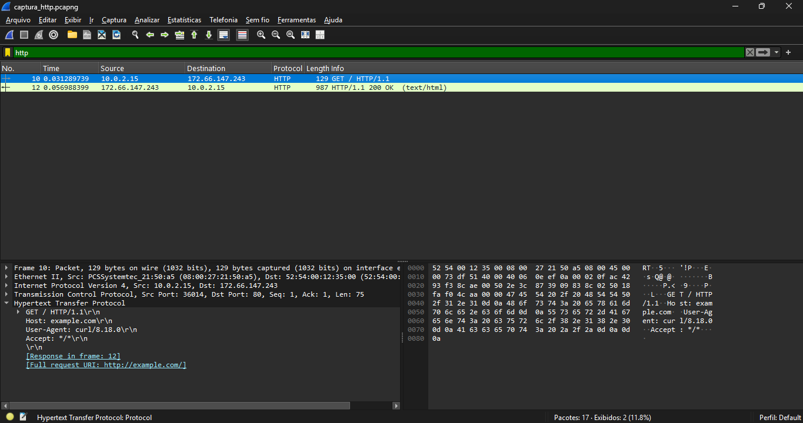

# Exercício 5 - Tráfego HTTP

**Integrantes:** Rafael Guimaraes, Álex Herivelton

## Arquivo de Captura
- `captura_http.pcapng`

## Como reproduzir
Iniciar a captura no Wireshark, rodar `curl http://example.com/` (ou abrir o site no navegador), parar a captura e aplicar o filtro `http`. Foi usado um site HTTP porque em HTTPS o conteúdo é criptografado.

## O que foi observado
Foi feita uma requisição HTTP simples (sem criptografia) ao site example.com. Na captura aparecem apenas dois pacotes HTTP: a requisição `GET /` enviada pela VM (10.0.2.15) e a resposta `200 OK` vinda do servidor 172.66.147.243. Como o tráfego HTTP não é criptografado, os cabeçalhos aparecem em texto puro no Wireshark, e dá para ler o método, o Host, o Content-Type e o Server.

## Captura de tela

## Análise dos Cabeçalhos HTTP
- **Método de requisição:** GET
- **URL acessada:** http://example.com/
- **Código de status da resposta:** 200 OK
- **Content-Type:** text/html; charset=utf-8
- **Server:** cloudflare
