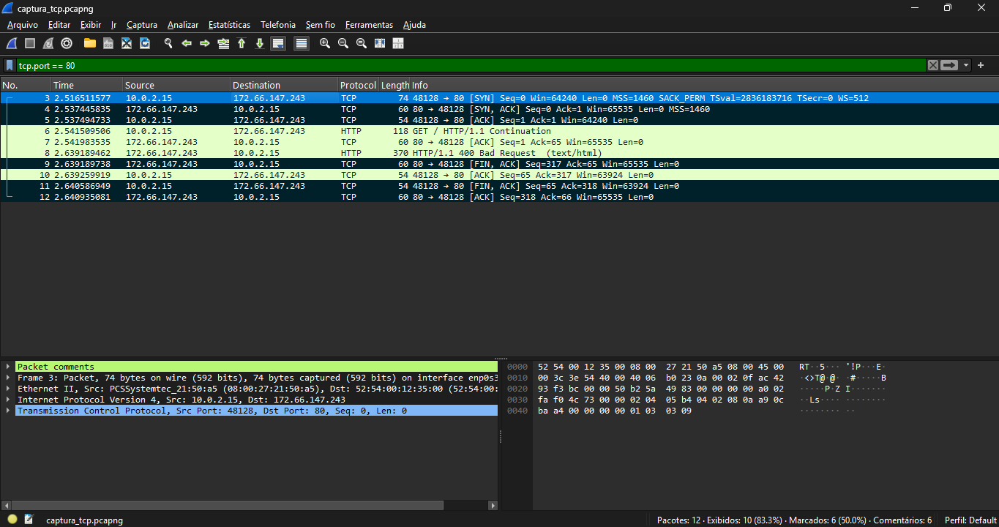

# Exercício 6 - Estabelecimento e Encerramento de Conexão TCP

**Integrantes:** Rafael Guimaraes, Álex Herivelton

## Arquivo de Captura
- `captura_tcp.pcapng`

## Como reproduzir
Iniciar a captura no Wireshark, rodar `telnet example.com 80`, digitar `GET / HTTP/1.1`, `Host: example.com` e `Connection: close` (Enter duas vezes no final), parar a captura e aplicar o filtro `tcp.port == 80`.

## O que foi observado
A conexão foi aberta com telnet na porta 80 de example.com. Na captura aparece o three-way handshake: SYN (pacote 3), SYN-ACK (pacote 4) e ACK (pacote 5). O servidor respondeu `400 Bad Request` (pacote 8), porque a requisição digitada no telnet não chegou no formato esperado, o que não interfere no exercício. Depois o servidor encerrou a conexão com FIN/ACK (pacote 9), o cliente respondeu com FIN/ACK (pacote 11) e o servidor mandou o ACK final (pacote 12), sem RST.

## Captura de tela

## Análise dos Pacotes TCP
- **Three-Way Handshake:**
  1. **SYN (Pacote nº 3):** 10.0.2.15:48128 → 172.66.147.243:80
  2. **SYN-ACK (Pacote nº 4):** 172.66.147.243:80 → 10.0.2.15:48128
  3. **ACK (Pacote nº 5):** 10.0.2.15:48128 → 172.66.147.243:80
- **Encerramento da Conexão:**
  - **FIN/ACK ou RST (Pacotes nº 9, 11 e 12):** FIN/ACK do servidor (9), FIN/ACK do cliente (11) e ACK final (12)
