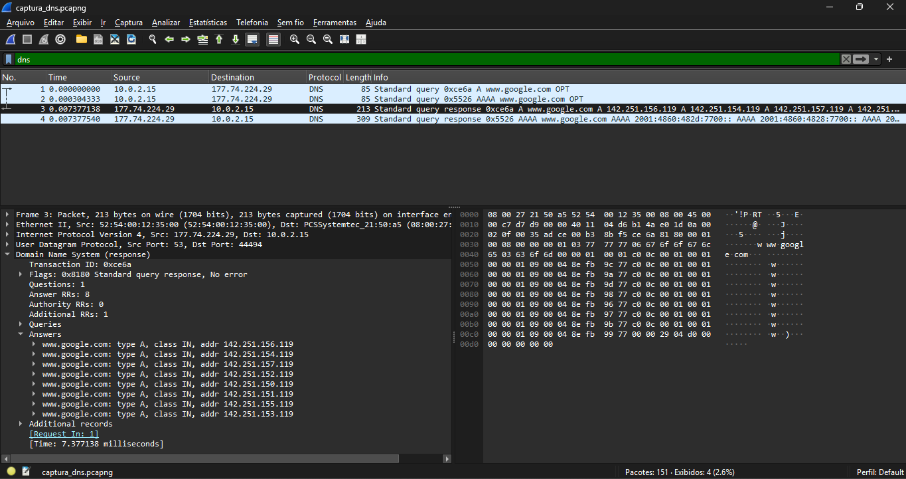

# Exercício 7 - Resolução de Nomes via DNS

**Integrantes:** Rafael Guimaraes, Álex Herivelton

## Arquivo de Captura
- `captura_dns.pcapng`

## Como reproduzir
Rodar `resolvectl flush-caches` para limpar o cache, iniciar a captura no Wireshark, acessar `www.google.com` (por exemplo com `curl https://www.google.com/`), parar a captura e aplicar o filtro `dns`.

## O que foi observado
Ao acessar www.google.com, a VM enviou duas consultas DNS ao servidor 177.74.224.29: uma do tipo A (IPv4) e outra do tipo AAAA (IPv6), quase ao mesmo tempo. O servidor respondeu com 8 endereços IPv4 e 8 endereços IPv6, o que mostra que o Google usa vários IPs para distribuir a carga. Antes da captura o cache DNS foi limpo para garantir que a consulta realmente saísse para a rede.

## Captura de tela

## Análise dos Pacotes DNS
- **Servidor DNS utilizado:** 177.74.224.29
- **Tipo de registro consultado:** A e AAAA
- **Registros retornados na resposta:**
  - A: 142.251.156.119, 142.251.154.119, 142.251.157.119, 142.251.152.119, 142.251.150.119, 142.251.151.119, 142.251.155.119, 142.251.153.119
  - AAAA: 2001:4860:482d:7700::, 2001:4860:4828:7700::, 2001:4860:482a:7700::, 2001:4860:4826:7700::, 2001:4860:482c:7700::, 2001:4860:4827:7700::, 2001:4860:482b:7700::, 2001:4860:4829:7700::
