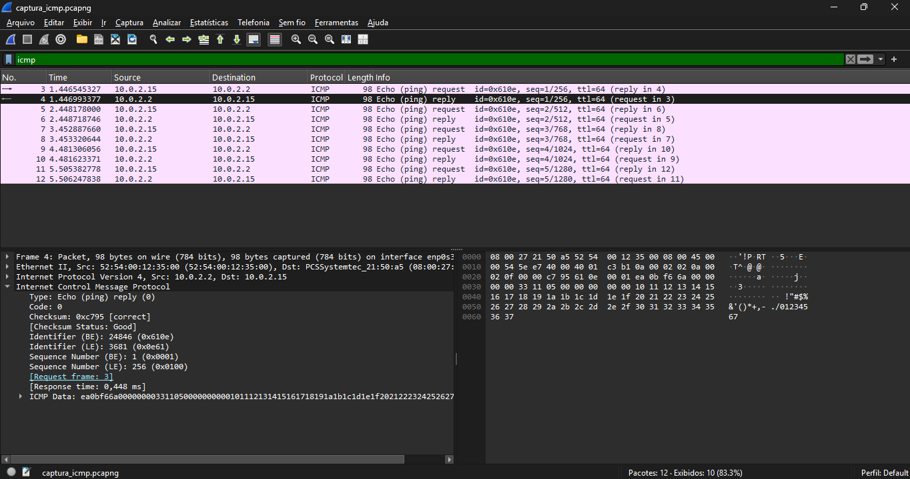

# Exercício 8 - Tráfego ICMP (ping)

**Integrantes:** Rafael Guimaraes, Álex Herivelton

## Arquivo de Captura
- `captura_icmp.pcapng`

## Como reproduzir
Iniciar a captura no Wireshark, rodar `ping -c 5 10.0.2.2` (gateway da rede da VM), parar a captura e aplicar o filtro `icmp`. O RTT aparece no campo *Response time* de cada Echo reply.

## O que foi observado
Foram enviados 5 pings (ICMP Echo Request) ao gateway 10.0.2.2, e todos receberam resposta (Echo Reply), sem perda de pacotes. O Wireshark calcula o tempo de ida e volta de cada par pelo campo Response time. Os RTTs ficaram entre 0,317 ms e 0,865 ms, valores bem baixos porque o gateway está na própria máquina (rede NAT da VirtualBox).

## Captura de tela

## Análise de Tempo de Ida e Volta (RTT)
- **Pacote 1:** 0,448 ms
- **Pacote 2:** 0,541 ms
- **Pacote 3:** 0,433 ms
- **Pacote 4:** 0,317 ms
- **Pacote 5:** 0,865 ms
