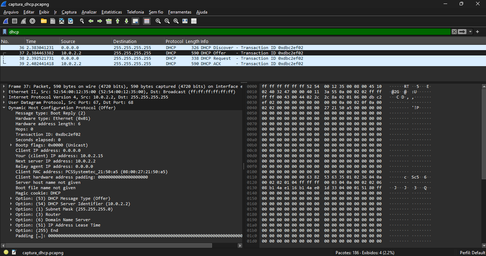

# Exercício 9 - Tráfego DHCP

**Integrantes:** Rafael Guimaraes, Álex Herivelton

## Arquivo de Captura
- `captura_dhcp.pcapng`

## Como reproduzir
Iniciar a captura no Wireshark e forçar uma nova negociação DHCP. Como o Ubuntu usado não tem o `dhclient`, foi usado o comando equivalente do NetworkManager: `sudo nmcli device disconnect enp0s3 && sudo nmcli device connect enp0s3`. Depois, parar a captura e aplicar o filtro `dhcp`.

## O que foi observado
Na captura aparece o processo DORA completo: o cliente (0.0.0.0) envia um Discover em broadcast, o servidor 10.0.2.2 responde com um Offer oferecendo o IP 10.0.2.15, o cliente pede esse IP com um Request e o servidor confirma com um ACK. As mensagens também entregam a máscara 255.255.255.0, o gateway 10.0.2.2, os servidores DNS e um tempo de concessão de 24 horas. Todo o processo levou cerca de 19 ms.

## Captura de tela

## Análise do Processo DORA
1. **Discover (Pacote nº 36):** broadcast do cliente, ainda sem IP (0.0.0.0)
2. **Offer (Pacote nº 37):** servidor 10.0.2.2 oferece o IP 10.0.2.15
3. **Request (Pacote nº 38):** cliente solicita o IP 10.0.2.15
4. **Ack (Pacote nº 39):** servidor confirma a concessão
